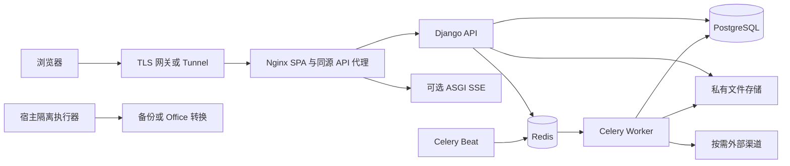

# AdminCore 系统结构

当前开发入口：[AGENTS.md](AGENTS.md) → [任务导航](docs/ai/README.md) → [能力地图](docs/ai/能力地图.md)。运行版本以 [版本要求](版本要求.md) 为准，产品/API/模块版本分别管理，见 [发布策略](docs/发布与版本策略.md)。

## 运行拓扑

完整 Compose 为 db/redis/backend/worker/beat/frontend 六服务；SSE 使用额外覆盖启用 realtime。精简为 db/backend/frontend。宿主备份、Office 转换、病毒扫描、外部供应商按专项配置启用，源码存在不代表已部署。所有 Python 执行角色必须使用同一发布代码/镜像，不能只更新 API。

## 源码职责

| 位置 | 负责内容 | 首读 |
|---|---|---|
| backend/config/ | settings、数据库/存储/扫描配置、URL、WSGI/ASGI、唯一产品版本 | [settings](backend/config/settings/base.py)、[URL](backend/config/urls.py) |
| backend/apps/auth_app/ | 账户、认证、会话、Cookie、TOTP、验证码、恢复 | [会话](backend/apps/auth_app/sessions.py) |
| backend/apps/users/ 与 permissions/ | 用户管理、RBAC、菜单、字段策略 | [权限执行](backend/apps/permissions/permissions.py) |
| backend/apps/core/ | 模块契约、组织任职、租户、数据范围、字典参数、列表、幂等与 outbox | [模块](backend/apps/core/modules.py)、[模型](backend/apps/core/models.py) |
| backend/apps/core/codegen/ | v1/v2 定义、生成、差异计划、公共业务运行时及跨能力接入 | [v2](backend/apps/core/codegen/spec_v2.py)、[运行时](backend/apps/core/codegen/runtime.py) |
| backend/apps/files/、data_io/、tasks/ | 私有文件与版本、导入导出账本、队列/调度/维护 | [能力地图](docs/ai/能力地图.md) |
| backend/apps/approvals/、reports/、online_forms/ | 多级条件流程、报表看板、版本化表单 | [能力地图](docs/ai/能力地图.md) |
| backend/apps/notifications/、logs/ | 通知模板/投递/订阅/摘要、操作/登录/异常/业务审计 | [审计](backend/apps/logs/audit.py) |
| backend/apps/sso/、api_credentials/、feature_flags/、ip_policy/ | 可选身份集成、机器凭证、灰度和 IP 策略 | [模块注册](backend/apps/core/modules.py) |
| backend/apps/example/ | 默认关闭的工单事务与扩展示例 | [服务](backend/apps/example/services.py) |
| frontend/src/api/、auth/、stores/ | 请求与 SDK、传输/令牌、认证与模块/导航状态 | [请求](frontend/src/api/request.ts)、[状态](frontend/src/stores/auth.ts) |
| frontend/src/router/、modules/ | 内置路由、页面准入、显式懒加载业务扩展 | [扩展](frontend/src/modules/registry.ts) |
| frontend/src/components/、composables/ | 组件与布局、查询状态、冲突、异步读取、离开保护 | [组件手册](docs/基础组件使用手册.md) |
| frontend/src/views/、i18n/、styles/ | 管理页面、国际化、CSS 主题令牌 | [前端指南](docs/前端开发指南.md) |
| examples/ | 可导入的生成定义、采购流程/报表、差旅表单 | [业务流程](docs/ai/业务开发流程.md) |
| backend/tests/、frontend/tests/、frontend/e2e/ | 后端回归、前端单元/组件与浏览器 fixture | [验证](docs/ai/验证与交付.md) |
| scripts/ | 创建/升级/发布、隔离基础设施验收与宿主执行器 | [CI](.github/workflows/checks.yml) |
| docs/、design-spec/ | 当前手册、日期验收证据、设计材料 | [任务导航](docs/ai/README.md) |

## 请求、写入与异步链路

1. 浏览器经统一请求层发起同源请求；路由守卫/按钮反映当前权限，后端独立执行认证、模块准入与授权。
2. 认证确认会话与租户；读取通过数据范围与字段白名单筛选。业务详情、关联、导出、报表、搜索不能绕过该链路。
3. 写服务在事务内复核账户/原会话/权限，按既有顺序锁定关联行，检查版本、状态与字段，再提交业务和审计；涉及可靠事件时同事务登记 outbox。
4. 后台执行者消费任务或事件，恢复可信租户并重新核对资格，执行有界副作用，记录状态与重试；SSE 仅提示客户端重新获取授权后的数据。
5. 私有文件使用鉴权接口，不直接公开媒体目录。备份和 Office 转换使用独立执行边界，不给 API 容器开放任意宿主执行权限。

具体顺序依目标模块实现；采购审批回写等跨能力操作须读目标服务和并发测试，不能从此概览推导锁顺序。安全约束见 [工程约束](docs/ai/工程约束.md)。

## 模块与二次开发

后端显式 Module/manifest 声明 API、页面、权限、菜单、参数、范围和后台任务；前端以编译时白名单登记可执行页面。不是扫描任意目录并动态执行远程代码的插件系统。运行时关闭仍保留 Django app/迁移/历史数据，精简构建才裁剪指定依赖和资源。

新业务放独立 app/页面，复用生成器与既有服务。生成模块 v2 的 extensions.py 与页面保留人工扩展；在线表单以发布快照保留历史记录，不能替代所有复杂业务建模。采购示例是接入定义，需要在隔离环境生成/安装，不代表默认部署已有采购系统。

## 当前验收与文档分工

[兼容性记录](COMPATIBILITY.md) 汇总最近一次完整 CI/服务器证据，日期文档保留当时结果。README 负责入口，架构负责职责和链路，能力地图负责代码定位，开发指南负责步骤与约束，测试与锁文件负责可执行契约。移动接入点时同步索引并执行文档检查。
